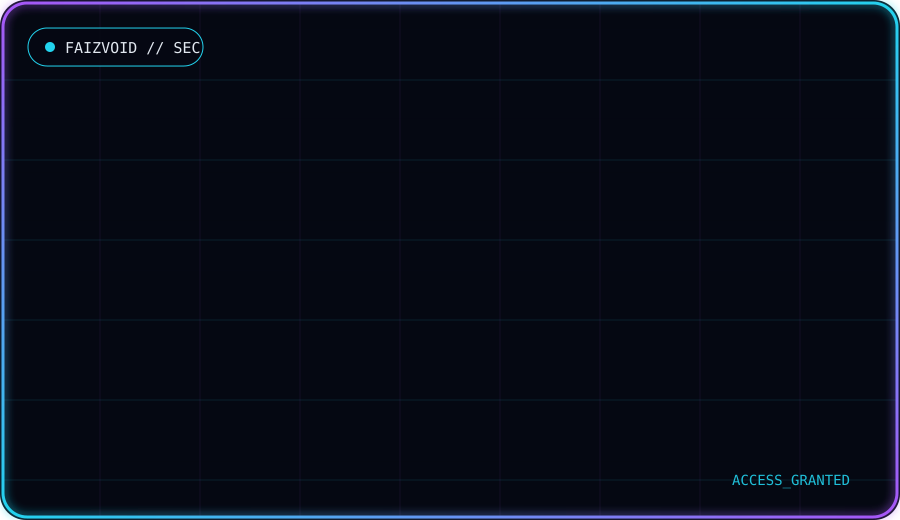
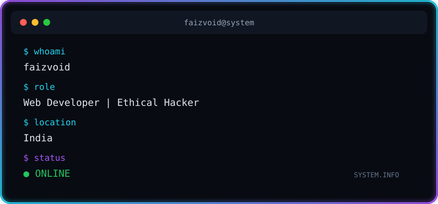

<div align="center">


<br/>


</div>

---

<div align="center">



</div>

---

<div align="center">



</div>

---

## `>_ whoami`

<table>
<tr>
<td width="220" align="center" valign="top">

</td>
<td valign="top">

```text
user      : faizvoid
role      : Web Developer | Ethical Hacker
location  : India
status    : building and breaking things, responsibly
```

I build for the web and I think like an attacker so what I build holds up.

</td>
</tr>
</table>

---

## `>_ skills`

<div align="center">


</div>

---

## `>_ featured_projects`

<table>
<tr>
<td width="50%" valign="top">

### 🤖 JarvisAI
Personal AI assistant project.

[](https://github.com/faizvoid/JarvisAI)

</td>
<td width="50%" valign="top">

### 🚀 LaunchKit
One of my web projects.

[](https://github.com/faizvoid/LaunchKit)

</td>
</tr>
<tr>
<td width="50%" valign="top">

### 🗂️ Task Management API
A task management backend API.

[](https://github.com/faizvoid/Task-Management-API)

</td>
<td width="50%" valign="top">

### 🍽️ Royal Bites
One of my web projects.

[](https://github.com/faizvoid/Royal-Bites)

</td>
</tr>
<tr>
<td width="50%" valign="top">

### 💐 Romantic Bouquet
One of my web projects.

[](https://github.com/faizvoid/Romantic-Bouquet)

</td>
<td width="50%" valign="top">

### 📂 More
Everything else lives in my repositories.

[](https://github.com/faizvoid?tab=repositories)

</td>
</tr>
</table>

---

## `>_ github_stats`

<div align="center">


</div>

---

## `>_ top_languages`

<div align="center">


</div>

---

## `>_ contributions`

<div align="center">


<br/><br/>


</div>

---

<div align="center">


<sub>Web Developer | Ethical Hacker • India</sub>


</div>